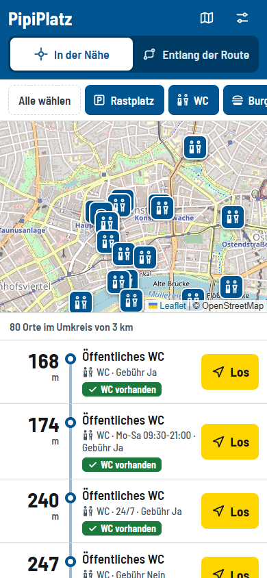

# PipiPlatz

Finds the nearest toilet stops in Germany, either **around you** or **along a route** on any road
(not only Autobahn). It is a small Flask backend plus a single-file Leaflet PWA with a German UI,
built for a phone in a car holder: the answer (what, how far, is there a WC) comes first.

**Live:** [pipiplatz.onrender.com](https://pipiplatz.onrender.com)



All data is free: OpenStreetMap through Overpass, OSRM for routing, Nominatim for address search.

## Features

- **In der Nähe**: stops around your position, sorted by distance.
- **Entlang der Route**: enter start and destination, get stops along the way with the distance ahead,
  the driving time to each one ("~22 min", from OSRM's planned speeds) and the detour. Radius and "how
  far ahead" are adjustable. An empty start means your current position.
- **The list follows you.** Back in the app after 30 s or more, it takes a fresh position and centres
  the map on it. A position update only re-filters the stops already loaded, it never searches again:
  on a route, stops you passed (more than 300 m) disappear and km / minutes count from where you are
  ("Alle gefundenen Stopps liegen hinter dir" at the end); nearby, the list is re-measured and re-sorted
  from the new position. A new search starts only when you start one.
- **The form is remembered**: start, destination, stops, Google link and the two selects are kept in
  `localStorage` between visits (nothing goes to the server). The app does not search on its own, and
  an empty start stays empty, so no search ever starts from yesterday's position.
- **Google-Maps-Link laden**: paste the share link of a route planned in Google Maps (short
  `maps.app.goo.gl`, long `/maps/dir/` links, or the `?saddr=…&daddr=…` form the phone's "Share"
  produces). Start, destination and the stops in between are read
  from it and the route is searched through them. The road line is calculated again with OSRM, so it
  can differ slightly from Google's, especially for alternative routes.
- **Route options:** when OSRM finds alternatives, "Suchen" first lists them with their main roads
  ("über A 3 · A 9"), distance and time, drawn on the map. Pick one, then search along it. OSRM does not
  always return the road you have in mind; if it is missing, add a stop on it.
- **Driving direction:** the "abseits" distance is measured to the road line itself, and a motorway
  stop that lies left of your direction within 150 m is on the other carriageway (the mirrored
  Raststätte). Those (Raststätte, Rastplatz, WC, McDonald's / Burger King, Tankstelle) are hidden behind a
  "anzeigen" bar; other places in the opposite direction stay
  in the list with an "andere Seite" note. A stop 1 km off the motorway is a normal detour over an
  exit and is never hidden.
- **The route form folds away**: tap the grip above it, or swipe it up, and only that bar stays; the map
  gets the room. Swipe it down or tap it again to open it, and the grip shows the chosen destination.
- **Filters** by place type, with an "Alle wählen / Alle abwählen" button. All types are on by
  default.
- **"Los"** opens Google Maps navigation to the stop. An optional embedded Google Maps view works
  with your own Maps Embed API key (stored in the browser only).
- Search overlay with a progress bar and a time estimate learned from your previous searches.
- **Double click / double tap on the map** hides the list and shows the map over the full height; the
  same gesture brings the list back. (That is why double click no longer zooms: pinch or the wheel do.)
- A place mapped twice in OSM (same type and name within 30 m, e.g. two fuel nodes) is listed once;
  rest areas are exempt, because their two carriageway halves share a name.
- A failed request (network error or a 5xx page while the free server wakes up) is retried twice
  before the app shows a German error; a failed background poll keeps the stops already shown.
- Installable PWA, light and dark theme.

## How the WC state is decided

OSM rarely tags toilets on shops, so the state is inferred per place type
(`classify`, `to_poi` and `enrich` in `app.py`):

| Place type | Rule |
|---|---|
| Raststätte, public WC | WC vorhanden |
| Rastplatz, parking with WC | WC vorhanden unless `toilets=no` |
| Tankstelle (every `amenity=fuel`, the WC tag is rare) | WC vorhanden unless `toilets=no` |
| McDonald's, Burger King | WC vorhanden, except pop-up or takeaway-only stores |
| Supermarket | WC wahrscheinlich if a café or seated bakery is within 80 m, otherwise unklar |
| Möbelhaus, Baumarkt (big chains by name) | WC wahrscheinlich if a café or restaurant is within 150 m; a Möbelhaus without one is still "wahrscheinlich", a Baumarkt "unklar" |
| Einkaufszentrum (`shop=mall`) | WC vorhanden |
| Bahnhof | WC vorhanden with `toilets=yes`; big DB stations (category 1-3) are "wahrscheinlich"; other stations are not listed |
| Ladepark (public charging, 8+ points or `toilets=yes`) | WC vorhanden with `toilets=yes`, "wahrscheinlich" with a café, restaurant, seated bakery or public WC within 150 m; parks without either are not listed. Stations within 150 m are one park (operators and points merged) |

An explicit `toilets=no` in OSM removes a Burger, Supermarkt, Möbelhaus, Baumarkt, Einkaufszentrum,
Bahnhof, Tankstelle or Ladepark entry. The UI shows three states: "WC vorhanden", "WC wahrscheinlich", "WC unklar".

## Run

```
pip install -r requirements.txt
python app.py        # http://localhost:5000, set PORT to change it
```

`truststore` is optional but recommended on Windows: it lets Python use the system certificate
store, which fixes `CERTIFICATE_VERIFY_FAILED` errors behind antivirus that inspects TLS.

## API

| Endpoint | Purpose |
|---|---|
| `GET /api/nearby?lat=&lon=` | Up to 80 stops around a point; the radius starts at 3 km (10 km on the Autobahn, rest areas kept first) and doubles up to 24 km until enough are found |
| `POST /api/along` | JSON `{from:[lat,lon], to:[lat,lon], via:[[lat,lon],...], radius, ahead_km, alt}` (`via`, `alt` optional); routes with OSRM and searches along the line. Each stop has `along`, `off`, `eta` (s from the start) and `opp` (other carriageway); `tl` is the route's distance/time line, `pending` the queries still running |
| `GET /api/geocode?q=` | Nominatim address search |
| `POST /api/routes` | JSON `{from, to, via}`; up to 3 route options with `roads`, `total`, `duration`, `route`; `/api/along` takes `alt` to pick one |
| `POST /api/gmaps` | JSON `{url}`; reads the stops of a Google Maps route link, returns `points` (start, stops, destination) |

## Caching and speed

- **Germany is answered from a local copy of the OSM data**, `data/pois.jsonl` (~80k stops plus the
  cafes / bakeries that decide "WC wahrscheinlich", 27.6 MB, built 2026-11-19). The server loads it once
  into a grid index (~3 s, ~60 MB RAM); a search box that lies wholly inside Germany never asks
  Overpass. Essen → Frankfurt: 4 s instead of 25-180 s, "In der Nähe" Frankfurt 0.6 s. Boxes that
  reach across the border (Aachen, Basel, abroad) still go to Overpass as below. The phone never
  downloads the file; it gets the same JSON answers as before.
- **The "am I on the Autobahn?" check** of "In der Nähe" (10 km radius instead of 3 km) uses
  `data/motorways.jsonl`, every `motorway` / `motorway_link` line simplified to 2 m (11.5 MB, ~10 MB
  RAM, ~6 ms per check instead of up to 6 s live).
- Every Overpass query is cached for 7 days in `cache.db` (SQLite), so a repeat search is fast.
- "In der Nähe" queries run around a ~2 km grid point instead of your exact position, so searches
  from nearby spots reuse the same cache entries. The radius is padded by the offset.
- Eleven public Overpass servers are used as fallbacks. If one is slow, the next starts after 10 s in
  parallel and the first valid answer wins; a host that failed recently is tried last.
- Name filters (`name~`) are slow on the public servers, so furniture and DIY chains are matched in Python.
- A cold search takes a few seconds when the servers are healthy (1.9 s measured for Frankfurt on
  2026-11-08) and much longer when they are overloaded.
- **Route searches do not wait for the whole route.** `/api/along` answers after at most 35 s
  (`ALONG_CUT`) with the stops it has by then (`pending` = queries still running); the rest keeps
  running on the server and its answers go into the cache. The app shows the first stops at once, says
  so in a notice, and picks the rest up in a few polls, so the list fills in while you drive. A query
  that just failed is not sent again for two minutes, so the polling does not turn into a retry loop.

### Updating the local data (by hand, every few weeks)

```
del data\germany-latest.osm.pbf    # build_pois.py downloads the current one from Geofabrik (~4.9 GB)
python build_pois.py               # ~10 min; refuses to write if a kind lost >10% (--force overrides)
python compare_local.py            # local vs live Overpass at 10 places, should say 10/10
python compare_local.py --random 100   # 100 places spread over Germany (~10 min)
python compare_local.py --motorway 200 # the Autobahn check at 200 points
python -u build_sides.py          # Autobahn sides, see below; first run ~4 h, later only new stops
git add data/pois.jsonl data/pois.meta.json data/motorways.jsonl data/sides.jsonl
```

**Autobahn sides** (`data/sides.jsonl`, ~11k stops: rest areas, motorway WCs, McDonald's / Burger King
and Tankstellen): a route search hides such a stop when only the other carriageway reaches it (driving through it costs >4 km more than driving on). That used to be one OSRM call
per stop and search, ~50 per route. `build_sides.py` asks OSRM once per stop and carriageway direction
(1 request per second, the public server's limit), measured from 1.5 km before to 1.5 km after the stop
along the real OSM carriageway. The app takes a stored answer only when the route drives that same
stretch and the detour is not within 1.5 km of the 4 km limit; otherwise it asks OSRM as before. On six
long routes 353 of 384 checks came from the file, and on routes that were not used to build it 374 of
448, all with OSRM's live verdict. Where the motorway ends within 1.5 km of a stop nothing is stored
and the app asks OSRM live. The script can be
stopped and started again; it keeps what it has.

The `.pbf` and `.poly` are git-ignored. Needs `pip install osmium` (only for the build, not on the server).
`build_pois.py` reads the selectors from `GROUPS` in `app.py`; a new group needs its first tag in
`PREFILTER` as well (a test checks that).

## On the phone

Geolocation and "Add to Home Screen" need **HTTPS**.

- Quick test: `cloudflared tunnel --url http://localhost:5000` gives an https URL.
- Permanent: deploy somewhere with HTTPS. The `Procfile` runs `gunicorn app:app`.
  iPhone: Safari, Share, "Zum Home-Bildschirm". Android: Chrome, "Install app".

### Hosting notes

- **PythonAnywhere (free):** outbound calls are limited to an allow-list. `overpass-api.de`,
  `overpass.openstreetmap.fr`, `overpass.kumi.systems`, `router.project-osrm.org` and
  `nominatim.openstreetmap.org` are on it (checked 2026-11-08). `ovp.dresel.systems`,
  `overpass.private.coffee` and `maps.mail.ru` are not. The free plan has one web app, one worker and
  a one-month expiry you have to renew.
- **Render (free):** the web service sleeps after 15 minutes idle and its disk is not kept, so the
  cache starts empty after a restart.

## Data and attribution

Map data © OpenStreetMap contributors (ODbL). The public Overpass, OSRM and Nominatim servers have
fair-use limits, so this is meant for personal use. The app sends the User-Agent
`PipiPlatz/1.0 (personal use)`.

## Known limits

- Google links give stops, not the road line. Stops given only by name are looked up in Nominatim and can
  be matched wrongly. Short links are followed from the server, which Google may answer with a
  consent page; then paste the long link.
- OSM coverage decides everything: a missing or wrong tag gives a wrong WC state.
- Chain names for furniture and DIY stores are matched by name and may miss some branches.
- Outside Germany, route searches send two Overpass queries per ~25 route points (one merged POI
  query, one for supermarket evidence). A 150 km route took 25 s cold on 2026-11-08; repeats come from
  the cache. Inside Germany the local data is only as fresh as its last build.
